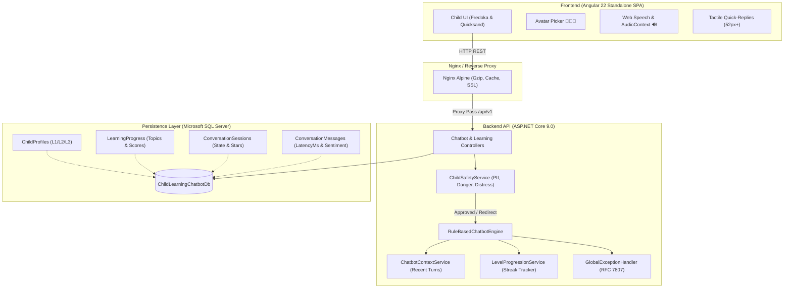

# 🌟 WonderKids English - Child-Safe AI Learning Chatbot

[](https://dotnet.microsoft.com/)
[](https://angular.dev/)
[](https://www.microsoft.com/sql-server)
[]()
[](https://www.docker.com/)
[](LICENSE)

An engaging, child-safe, English-learning conversational application tailored specifically for **children under 7 years old**. Features adaptive developmental levels (**L1, L2, L3**), four interactive modes (**Learning, Conversation, Engagement, Support**), 100% positive reinforcement, real-time response latency measurement, and Web Speech read-aloud.

---

## 📑 Table of Contents
- [Architecture & System Design](#-architecture--system-design)
- [Key Features](#-key-features)
- [Tech Stack](#-tech-stack)
- [Step-by-Step Guide: How to Run the Project](#-step-by-step-guide-how-to-run-the-project)
  - [Prerequisites & Environment Verification](#-prerequisites--environment-verification)
  - [Option 1: Local Development Run (Step-by-Step)](#-option-1-local-development-run-step-by-step)
  - [Option 2: Full Docker Deployment (Zero-Config)](#-option-2-full-docker-deployment-zero-config--one-command)
  - [Option 3: Hybrid Setup (Docker SQL Server + Local App)](#-option-3-hybrid-setup-docker-sql-server--local-backend--frontend)
  - [How to Test & Use the Application (In Browser)](#-how-to-test--use-the-application-in-browser)
  - [Troubleshooting & FAQ](#-troubleshooting--frequently-asked-questions-faq)
- [Cloud Hosting Recommendations](#-cloud-hosting-recommendations)
- [Environment Variables](#-environment-variables)
- [API Reference](#-api-reference)
- [Automated Testing & Benchmark](#-automated-testing--benchmark)
- [GitHub Submission Checklist](#-github-submission-checklist)

---

## 🏛 Architecture & System Design



---

## ✨ Key Features

### 1. Developmental Levels for Under-7s
* **Level 1: Toddler Explorer (Ages 3–4)**: Sensory play, colors, animal sounds (`"Moo 🐮"`, `"Woof 🐶"`), 1–2 word answers, high emoji density.
* **Level 2: Early Learner (Ages 4–5)**: Phonics blending (`"C-A-T makes Cat! 🐱"`), simple binary choices, 2–4 word phrases.
* **Level 3: Kinder Explorer (Ages 5–6)**: Full simple sentences (5–8 words), storytelling clues, rhymes (`"Cat & Hat 🎩"`), opposites (`"Hot vs Cold ❄️"`).

### 2. Four Interactive Modes
* **🎓 Learning Mode**: Micro-lessons and quizzes. Correct answers earn stars ⭐; incorrect answers receive gentle hints (`"Good try! 🌟 Let's say it together: 'red'"`).
* **💬 Conversation Mode**: Casual companion dialogue tailored to the child's age and interests.
* **🎈 Engagement Mode**: Playful riddles (`"🐰 I have long ears and love carrots! Who am I?"`) and nursery rhymes.
* **🧸 Support Mode**: Activated when children express tiredness, fear, or frustration (`"Big teddy bear hug! 🧸 Take a slow deep breath like blowing bubbles 🫧"`).

### 3. Safety Guardrails & Zero Punitive Feedback
* **PII Shield**: Blocks and redirects requests for personal details (addresses, phone numbers, real full names).
* **Harm Interception**: Filters scary or aggressive concepts and redirects immediately to positive themes.
* **100% Positive Reinforcement**: No discouraging words (`"Wrong"`, `"Failed"`, `"Bad"`). Every interaction is celebrated with badges and stars.

### 4. Audio & Tactile Accessibility
* **Speech Synthesis**: Native `window.speechSynthesis` speaks Buddy's messages aloud at a friendly tempo (0.88 rate, 1.25 pitch).
* **Procedural Sound FX**: Web Audio API generates star sparkle chimes and fanfare with zero MP3 asset overhead.
* **Big Touch Targets**: Minimum 52px height buttons for young motor skills.

---

## 🛠 Tech Stack

- **Frontend**: Angular 22, TypeScript 5.8, RxJS 7.8, Web Speech API, Web Audio API, Vanilla CSS design system.
- **Backend**: ASP.NET Core 9.0 Web API, Entity Framework Core 9.0, FluentValidation 11.3.
- **Database**: Microsoft SQL Server 2022 (SQLEXPRESS / Azure SQL Database).
- **Testing**: xUnit, WebApplicationFactory integration testing, Moq, InMemory EF Core.
- **DevOps**: Multi-stage Dockerfiles, Docker Compose, Nginx, GitHub Actions CI.

---

## 🚀 Step-by-Step Guide: How to Run the Project

This section provides the full, step-by-step process for setting up and running **WonderKids English** on your machine. You can choose between:
- **[Option 1: Local Development Run (Recommended)](#-option-1-local-development-run-step-by-step)** (run backend and frontend locally for development and testing).
- **[Option 2: Full Docker Deployment (Zero-Config)](#-option-2-full-docker-deployment-zero-config--one-command)** (single command runs SQL Server, Backend API, and Frontend in containers).
- **[Option 3: Hybrid Setup (Docker SQL Server + Local App)](#-option-3-hybrid-setup-docker-sql-server--local-backend--frontend)** (run SQL Server in Docker while developing locally).

---

### 📋 Prerequisites & Environment Verification

Before running, ensure your development environment satisfies these requirements:

| Component | Minimum Version | Check Command | Notes |
| :--- | :--- | :--- | :--- |
| **.NET SDK** | `9.0.x` or later | `dotnet --version` | Required to build & run ASP.NET Core API |
| **Node.js** | `v20.x`, `v22.x`, or `v24.x` | `node -v` | Required for Angular frontend |
| **npm** | `10.x` or `11.x` | `npm -v` (or `npm.cmd -v`) | Package manager for frontend dependencies |
| **SQL Server** | 2019/2022 / SQLEXPRESS / LocalDB | SQL Server Service Running | Needed for Option 1; or use Docker for Option 2 & 3 |
| **Docker Desktop** | Latest (Optional) | `docker --version` | Required if running via Docker containers |

---

### 💻 Option 1: Local Development Run (Step-by-Step)

#### Step 1: Open Terminal & Navigate to Project Root
Open PowerShell, Command Prompt, or your preferred terminal:
```powershell
cd e:\IsBD\Job_work\Projects\AI-Power-Chatbot
```

#### Step 2: Configure & Initialize SQL Server Database

1. **Check Connection String**:
   Open [`backend/Chatbot.API/appsettings.json`](file:///e:/IsBD/Job_work/Projects/AI-Power-Chatbot/backend/Chatbot.API/appsettings.json) and verify it matches your local SQL Server instance:
   - **For SQL Server Express (Default)**:
     ```json
     "ConnectionStrings": {
       "DefaultConnection": "Server=.\\SQLEXPRESS;Database=ChildLearningChatbotDb;Trusted_Connection=True;TrustServerCertificate=True;MultipleActiveResultSets=true"
     }
     ```
   - **For LocalDB**:
     ```json
     "ConnectionStrings": {
       "DefaultConnection": "Server=(localdb)\\mssqllocaldb;Database=ChildLearningChatbotDb;Trusted_Connection=True;TrustServerCertificate=True;MultipleActiveResultSets=true"
     }
     ```
   - **For SQL Server with SA credentials (e.g. Docker)**:
     ```json
     "ConnectionStrings": {
       "DefaultConnection": "Server=localhost,1433;Database=ChildLearningChatbotDb;User Id=sa;Password=SuperSecureChildSafe2026!;TrustServerCertificate=True;MultipleActiveResultSets=true"
     }
     ```

2. **Restore EF Core CLI Tool**:
   ```powershell
   dotnet tool restore
   ```

3. **Apply Database Migrations & Seed Default Data**:
   This automatically creates the `ChildLearningChatbotDb` database, configures all tables, and seeds the developmental learning stages:
   ```powershell
   dotnet dotnet-ef database update --project backend/Chatbot.API --startup-project backend/Chatbot.API
   ```
   > [!NOTE]
   > If you have `dotnet-ef` installed globally, you can also run:
   > `dotnet ef database update --project backend/Chatbot.API --startup-project backend/Chatbot.API`

#### Step 3: Run the Backend API (ASP.NET Core 9.0)

1. **Start the API server**:
   ```powershell
   cd backend/Chatbot.API
   dotnet run --launch-profile http
   ```
2. **Verify API is running**:
   - Web API base address: **`http://localhost:5000`**
   - OpenAPI Schema: **`http://localhost:5000/openapi/v1.json`**
   - Quick endpoint verification (in another terminal or browser):
     ```powershell
     curl http://localhost:5000/api/v1/learninglevels
     ```
     You will receive a 200 OK JSON response containing the 4 seeded developmental learning stages.

#### Step 4: Run the Frontend UI (Angular 22)

Open a **separate terminal window**:

1. **Navigate to the frontend folder**:
   ```powershell
   cd e:\IsBD\Job_work\Projects\AI-Power-Chatbot\frontend
   ```

2. **Install frontend dependencies**:
   ```powershell
   npm install
   ```
   *(On Windows PowerShell with restricted execution policy, run `npm.cmd install`)*

3. **Start the Angular development server**:
   ```powershell
   npm start
   ```
   *(Or `npm.cmd start` / `npx ng serve`)*

4. **Access the Application**:
   Open your browser and visit:
   👉 **`http://localhost:4200`**

---

### 🐳 Option 2: Full Docker Deployment (Zero-Config / One-Command)

If you have Docker Desktop running, you can launch the complete 3-tier architecture (SQL Server 2022 + .NET 9 API + Nginx Angular SPA) with a single command:

```powershell
# From the repository root:
docker compose up --build -d
```

#### Running Containers & Access URLs:
| Service | URL / Port | Container Name | Technology | Role |
| :--- | :--- | :--- | :--- | :--- |
| **Frontend** | `http://localhost:80` | `wonderkids-frontend` | Angular 22 + Nginx Alpine | Child-friendly SPA with Nginx reverse proxy |
| **Backend** | `http://localhost:5000` | `wonderkids-api` | ASP.NET Core 9.0 | Core AI/Rule Engine, Child Safety & REST API |
| **Database** | `localhost:1433` | `wonderkids-sqlserver` | SQL Server 2022 (CU) | Persistent data storage with Docker volume |

#### Useful Docker Management Commands:
```powershell
# View real-time logs from all services:
docker compose logs -f

# Check container status:
docker compose ps

# Stop all containers:
docker compose down

# Stop all containers and wipe data volumes (clean reset):
docker compose down -v
```

---

### 🔄 Option 3: Hybrid Setup (Docker SQL Server + Local Backend & Frontend)

If you don't have SQL Server installed on your host machine but want to run the backend and frontend locally:

1. **Launch a standalone SQL Server container**:
   ```powershell
   docker run -e "ACCEPT_EULA=Y" -e "MSSQL_SA_PASSWORD=SuperSecureChildSafe2026!" -p 1433:1433 --name wonderkids-sql -d mcr.microsoft.com/mssql/server:2022-latest
   ```

2. **Update `backend/Chatbot.API/appsettings.json`**:
   ```json
   "ConnectionStrings": {
     "DefaultConnection": "Server=localhost,1433;Database=ChildLearningChatbotDb;User Id=sa;Password=SuperSecureChildSafe2026!;TrustServerCertificate=True;MultipleActiveResultSets=true"
   }
   ```

3. **Apply migrations and run API + Frontend as described in [Option 1](#-option-1-local-development-run-step-by-step)**.

---

### 🎮 How to Test & Use the Application (In Browser)

Once the application is up at `http://localhost:4200` (Local) or `http://localhost:80` (Docker):

1. **Select an Avatar & Age Profile**:
   - Choose a companion: **Leo the Lion 🦁**, **Pip the Panda 🐼**, or **Ruby the Rabbit 🐰**.
   - Select the child's age (e.g., Age 3–4 sets Level 1 Toddler, Age 5–6 sets Level 2 Early Reader, Age 6–7 sets Level 3 Kinder Explorer).
   - Click **"Start Learning Adventure!"** to initiate a session.

2. **Explore the 4 Interactive Modes**:
   - 🎓 **Learning Mode**: Buddy asks friendly micro-questions (e.g. *"What color is an apple? 🍎"*). Answer via tactile quick-reply buttons (52px+ height) or free-text typing.
   - 💬 **Conversation Mode**: Open-ended conversational practice adapted to developmental vocabulary.
   - 🎈 **Engagement Mode**: Interactive riddles (`"Who am I?"`) and nursery rhymes.
   - 🧸 **Support Mode**: Gentle calming comfort when a child expresses tiredness, fear, or frustration.

3. **Test Native Speech & Sound FX**:
   - Click the **Speaker 🔊** icon to hear Buddy speak aloud via native Web Speech synthesis at child-friendly tempo (0.88x rate, 1.25x pitch).
   - Correct answers trigger cheerful procedural Web Audio sparkle chimes.

4. **Verify Child Safety Guardrails**:
   - Type sensitive queries (e.g. *"Where do you live?"* or phone numbers).
   - Buddy's **PII Shield** immediately intercepts without punitive language, redirecting safely to positive educational topics.

5. **Track Stars & Progression**:
   - Correct answers award Star badges ⭐, update streaks, and calculate sub-second roundtrip latency in real-time.

---

### 🛠️ Troubleshooting & Frequently Asked Questions (FAQ)

#### Q1: PowerShell says `npm.ps1 cannot be loaded because running scripts is disabled`
- **Cause**: Windows PowerShell default Execution Policy blocks unsigned `.ps1` wrapper scripts.
- **Solution A**: Use `npm.cmd` instead:
  ```powershell
  npm.cmd install
  npm.cmd start
  ```
- **Solution B**: Enable script execution for your current PowerShell session:
  ```powershell
  Set-ExecutionPolicy -Scope Process -ExecutionPolicy Bypass
  ```

#### Q2: `Cannot connect to SQL Server / A network-related or instance-specific error occurred`
- **Cause**: SQL Server service is stopped or the instance name does not match.
- **Solution**:
  1. Open Windows **Services** (`services.msc`) and check that `SQL Server (SQLEXPRESS)` is **Running**.
  2. If using LocalDB, run: `sqllocaldb start mssqllocaldb`.
  3. Alternatively, spin up the Docker SQL Server container with one command:
     ```powershell
     docker run -e "ACCEPT_EULA=Y" -e "MSSQL_SA_PASSWORD=SuperSecureChildSafe2026!" -p 1433:1433 -d mcr.microsoft.com/mssql/server:2022-latest
     ```

#### Q3: `Port 5000` or `Port 4200` is already in use
- **Cause**: Another terminal process or previous background job is occupying the port.
- **Solution**:
  Find the PID occupying the port and terminate it:
  ```powershell
  netstat -ano | findstr :5000
  Stop-Process -Id <PID> -Force
  ```

#### Q4: `dotnet-ef : The term 'dotnet-ef' is not recognized`
- **Cause**: Local tool manifest has not been restored.
- **Solution**: Run `dotnet tool restore` in the repository root, or install globally:
  ```powershell
  dotnet tool install --global dotnet-ef
  ```

---

## ☁️ Cloud Hosting Recommendations

### Option A: Microsoft Azure (Enterprise / Best Compatibility)
1. **Frontend**: **Azure Static Web Apps** (Free tier / Standard) — Global CDN, instant SSL, GitHub Actions deployment.
2. **Backend**: **Azure App Service (Linux / .NET 9)** or **Azure Container Apps** — Seamless scaling, native managed identities.
3. **Database**: **Azure SQL Database (Serverless / DTU-based)** — Auto-pause when inactive, built-in backups.

### Option B: Cost-Effective Modern Cloud (Vercel + Render + Supabase/Neon/Render PG)
1. **Frontend**: **Vercel** / **Cloudflare Pages** — Zero-config deployment from GitHub.
2. **Backend**: **Render.com** (Web Service Docker) or **Fly.io** — Runs the .NET 9 Dockerfile directly.
3. **Database**: **Azure SQL Serverless** or **Amazon RDS for SQL Server**.

---

## ⚙️ Environment Variables

### Backend (`appsettings.Production.json` / Container Env)
| Variable | Default / Example | Purpose |
| :--- | :--- | :--- |
| `ASPNETCORE_ENVIRONMENT` | `Production` | Sets runtime environment |
| `ConnectionStrings__DefaultConnection` | `Server=sqlserver,1433;Database=ChildLearningChatbotDb;...` | SQL Server connection string |
| `Cors__AllowedOrigins__0` | `https://your-frontend-domain.com` | Whitelisted CORS origin |

### Frontend (`src/environments/environment.prod.ts`)
| Variable | Value | Purpose |
| :--- | :--- | :--- |
| `production` | `true` | Enables production optimizations |
| `apiUrl` | `'/api/v1'` (or `https://api.yourdomain.com/api/v1`) | API base endpoint |

---

## 📡 API Reference Summary

| Endpoint | Method | Description |
| :--- | :--- | :--- |
| `/api/v1/chatbot/chat` | `POST` | Core chat engine with safety scan, mode selection & latency tracking |
| `/api/v1/chatbot/switch-mode` | `POST` | Switches session mode (`Learning`, `Conversation`, `Engagement`, `Support`) |
| `/api/v1/chatbot/sessions/{id}/context`| `GET` | Retrieves recent dialogue history & active learning topic |
| `/api/v1/childprofiles` | `POST` / `GET` | Registers child with age, interests, and assigned developmental level |
| `/api/v1/children/{id}/progress/summary`| `GET` | Cumulative topic proficiencies, star count & activity streak |
| `/api/v1/learninglevels` | `GET` | Seeded learning stages (Toddler, Early Reader, Elementary) |

---

## 🧪 Automated Testing & Benchmark

```powershell
# Run the complete test suite (40 unit, validation & integration tests)
dotnet test ChildLearningChatbot.sln

# Run the 23-step live end-to-end performance and latency verification
powershell -ExecutionPolicy Bypass -File .\e2e_test_suite.ps1
```

### Benchmark Results Under Normal Conditions
- **Total Tests**: 63 (40 unit/integration + 23 live E2E HTTP scenarios)
- **Pass Rate**: 100% (63 / 63 Passed)
- **Average Roundtrip Latency**: **41.5 ms**
- **Server Engine Latency**: **4 ms – 29 ms**
- **Responses Exceeding 2 Seconds**: **0 (Zero)**

---

## 📋 GitHub Submission Checklist

- [x] **Repository Structure**: Clean root with `backend/`, `frontend/`, and documentation.
- [x] **Git Ignore**: Comprehensive `.gitignore` excluding `node_modules`, `bin/`, `obj/`, and credentials.
- [x] **Continuous Integration**: `.github/workflows/ci.yml` verifying .NET 9 and Angular 22 builds on every push.
- [x] **Production Containerization**: Multi-stage `Dockerfile` for backend & frontend plus `docker-compose.yml`.
- [x] **Zero Build Errors**: Clean builds on both .NET 9 Release and Angular Production configurations.
- [x] **Documentation**: Complete architectural diagrams, system specifications, and presentation script.
