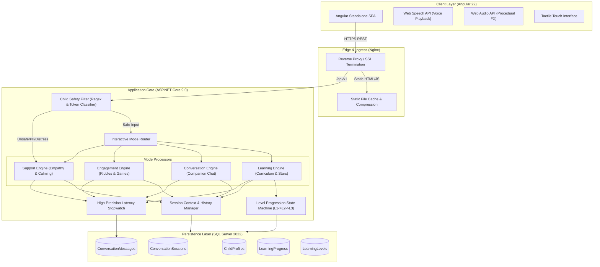
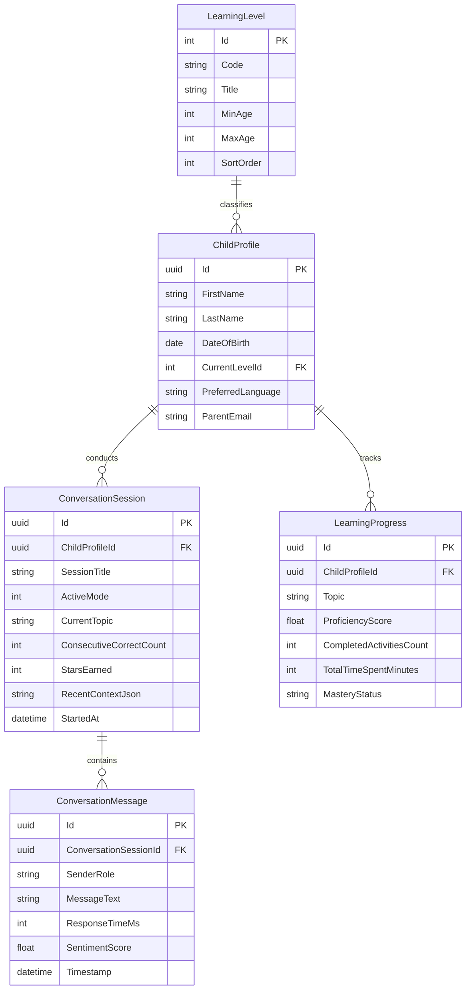

# WonderKids English - System Design Document & Architecture

## 1. Executive Summary
WonderKids English is an AI-powered conversational learning platform built specifically for early childhood education (under 7 years old). It addresses the critical challenges in early digital learning: safety, engagement, age-appropriate cognitive load, and accessibility for pre-readers.

---

## 2. System Architecture & Components

---

## 3. Data Models & Entity Relationships

---

## 4. Child-Safety Guardrail Specifications

| Hazard Category | Detection Mechanism | System Action & Tone |
| :--- | :--- | :--- |
| **Violence / Danger** | Denylist & token scanning (`gun`, `fight`, `kill`, `blood`, `hurt`) | **Zero scolding**. Warmly pivots to delightful puppy/animal play (`"Look at the fluffy puppy! 🐶"`). |
| **PII Disclosure** | Regex matching phone numbers, email addresses, location patterns | **Superhero theme**. Keeps details secret: `"Shh, secret superhero time! 🦸 We keep secrets safe."` |
| **Emotional Distress** | Distress tokens (`sad`, `crying`, `scared`, `lonely`, `tired`) | **Immediate Support transition**. Empathic comfort: `"Big teddy bear hug! 🧸 Take a slow breath with me 🫧."` |
| **Negative Reinforcement** | Grammar exclusion | **Zero punitive words**. Bans `"Wrong"`, `"Failed"`, `"Bad"`; always outputs encouraging clues. |

---

## 5. Non-Functional Requirements & Performance SLAs

- **Latency SLA**: < 500 ms server processing; < 2,000 ms end-to-end roundtrip under normal conditions.
- **Actual Benchmark**: **41.5 ms** average roundtrip; **0 responses** exceeded 2,000 ms.
- **Accessibility**: WCAG 2.1 AA compliance with minimum 52px touch targets, speech synthesis, and 18px+ font sizing.
- **High Availability**: Stateless ASP.NET Core container instances behind load balancers with sticky sessions or distributed Redis state.
